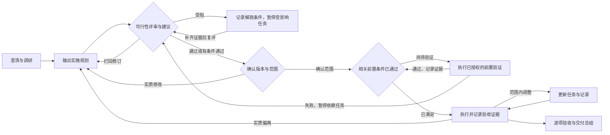

# plan-first

> 先规划，后编码 —— 约束 AI Agent（和人类）在动手写代码前，先完成系统性实施规划的工程实践 Skill。

**English TL;DR:** plan-first helps coding agents plan and review multi-step or high-impact engineering work, verify prerequisites, execute within the confirmed scope, and resume from actual results and acceptance evidence. [Read SKILL.md](./SKILL.md) for the workflow.

## 解决什么问题

AI 编码助手拿到需求的第一反应是开写。写到一半才发现：

- 需求理解偏了，方向性返工
- 依赖模块没调研，选型和现有工程约定冲突
- 任务没有边界，"顺手"越做越大
- 做完说不清"完成"的标准是什么

完整流程如下。只要求规划或评审时，到交付对应结果为止。



执行规则

1. 调研时区分已验证事实、假设和证据缺口。
2. 按已确认的规划版本与范围实施，先通过对应前置验证。
3. 超出确认范围的变更先复评并重新确认。
4. 中断恢复时先核对实际成果、依赖和验收证据。

## 产出什么

一份结构化实施规划文档（[模板见此](./references/plan-template.md)，[完整示例见此](./examples/example-plan.md)）：

| 节 | 内容 |
|----|------|
| 背景与目标 | 含明确的**非目标**，防范围蔓延 |
| 现状调研结论 | 从代码里读到的事实，含文件路径 |
| 验收标准 | 可验证的"完成"定义 |
| 任务拆解表 | ID / 任务 / 优先级 P0–P2 / 依赖 / 预期产出 / 验收方式 / 状态及证据 |
| 实施顺序 | 依赖优先，里程碑节点 |
| 风险与待确认项 | 含需要用户拍板的决策 |
| 可行性评审结论 | 三项固定检查、证据或证据缺口、前置动作与放行标准 |
| 方案建议 | **实施建议**（步骤和注意事项）/ **优化建议**（方向和处置）/ **修改建议**（问题、改法和理由） |
| 变更记录 | 版本变更、原因和确认记录 |

规划文档记录预期、决策和验证结果。跨会话接手时，以实际成果和验收证据核对任务状态。工作区不可写时，可在会话中交付规划，并说明保存状态。

## 安装

**Codex**　将包含 `SKILL.md` 的源码目录或发布包内的 `plan-first` 目录复制到 `$CODEX_HOME/skills/plan-first/`。未配置 `CODEX_HOME` 时使用 `~/.codex/skills/plan-first/`。确认 `SKILL.md` 位于该目录下，并保留 `references/plan-template.md` 的相对位置。在新会话确认 Skill 已出现，再用 `$plan-first` 显式调用。

其他宿主按各自的 Skill 加载方式安装，并验证能读取主指令和模板。自动选择由宿主决定。

## 使用

以下示例展示完整流程中的范围确认。

```
你：帮我给博客加一个用户登录功能

Agent：规划 v1 包含注册、登录、评论关联和密码找回。请确认本期实施范围。

你：密码找回先不做，其他 OK

Agent：v2 的实施范围是注册、登录和评论关联。请确认按 v2 开始。
你：确认按 v2 开始。
```

对话中也可以显式触发：

- "先规划一下" / "先出个方案" / "做个任务拆解" / "评审一下可行性" / "给点实施/优化/修改建议"
- "直接做，别规划"（显式跳过）

**轻量模式**　影响有限但需要交代做法的任务，在会话中说明步骤、产出、主要风险和验收方式。实施范围已有明确授权时继续推进，有待决策的取舍先确认。涉及数据、生产环境或难以逆转的改动时，按影响和风险选择完整流程。

## 设计取舍

- **确认范围**　使用已明确给出的实施授权，另行确认新增的范围、外部副作用和关键决策。
- **为什么规划后必须做可行性评审**：规划写得漂亮不等于方案成立。评审固定查三件事——设计假设和代码/数据/依赖是否冲突、哪些"未知"被当成了"已知"、哪些缺口会导致返工。结论落进文档而不是留在对话里，是为了让评审结果可追溯、可复查。
- **为什么建议要分实施/优化/修改三类**：三类建议对应的读者动作不同——实施建议是"照着做"，优化建议是"择机做"，修改建议是"必须决策"。混在一起，必须处理的修改会被"nice to have"淹没；分开写并要求逐条可追溯，建议才不会退化成口号。
- **规划与恢复**　记录确认版本、任务依赖和验收证据，便于接手时核对进度及可安全继续的工作。

## FAQ

**Q：会不会太重？**
低风险单点小修可以直接处理。轻量任务保留简要说明，完整规划用于多步骤或高影响的工作。

**Q：规划错了怎么办？**
在变更记录中注明原因和影响。实质变更需要形成修订版，复评受影响部分并确认范围。

**Q：可行性评审和风险清单有什么区别？**
风险清单是"我知道可能出问题"的主观罗列；可行性评审是对规划本身做事实核查——拿设计假设去比对代码/数据/依赖的实际状态，把没验证过的"已知"点名为假设。一个向前看（会发生什么），一个向后查（写下的东西站得住吗）。

**Q：和 Plan Mode（计划模式）什么区别？**
Plan Mode 是工具层面的能力；plan-first 是工程方法论，规定了规划的内容结构、优先级体系、验收标准和执行期同步规则，两者可以叠加使用。

## License

[MIT](./LICENSE)
