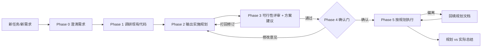

# plan-first

> 先规划，后编码 —— 约束 AI Agent（和人类）在动手写代码前，先完成系统性实施规划的工程实践 Skill。

**English TL;DR:** plan-first is a skill for AI coding agents that follow the `SKILL.md` convention (Claude Code, WorkBuddy, etc.). It forces a structured planning phase — task breakdown, priorities, expected deliverables, acceptance criteria — plus a mandatory feasibility review (assumption conflicts, unknowns treated as knowns, rework gaps) and three kinds of actionable recommendations (implementation / optimization / fixes) before any code gets written, requires explicit user confirmation of the plan, then keeps the plan document in sync with the actual implementation. [Read the SKILL.md](./SKILL.md) for details.

## 解决什么问题

AI 编码助手拿到需求的第一反应是开写。写到一半才发现：

- 需求理解偏了，方向性返工
- 依赖模块没调研，选型和现有工程约定冲突
- 任务没有边界，"顺手"越做越大
- 做完说不清"完成"的标准是什么

plan-first 在「需求」和「编码」之间强制插入两道关卡：**规划 → 可行性评审 + 方案建议 → 确认**：



五条铁律：

1. 规划前必读现有代码，禁止凭空假设工程约定
2. 规划未获确认，不写业务代码
3. 规划完成后必须过可行性评审并输出方案建议，评审结论与建议落进文档，不能只在对话里说
4. 执行偏离规划，先回填文档再继续
5. 计划外新任务，先入表再实施

## 产出什么

一份结构化实施规划文档（[模板见此](./references/plan-template.md)，[完整示例见此](./examples/example-plan.md)）：

| 节 | 内容 |
|----|------|
| 背景与目标 | 含明确的**非目标**，防范围蔓延 |
| 现状调研结论 | 从代码里读到的事实，含文件路径 |
| 验收标准 | 可验证的"完成"定义 |
| 任务拆解表 | ID / 任务 / 优先级 P0–P2 / 依赖 / 预期产出 / 验收方式 |
| 实施顺序 | 依赖优先，里程碑节点 |
| 风险与待确认项 | 含需要用户拍板的决策 |
| 可行性评审结论 | 假设冲突 / 未知当已知 / 返工缺口，三项固定检查，每项给证据 |
| 方案建议 | **实施建议**（落地步骤+注意事项）/ **优化建议**（可改进处+方向+处置）/ **修改建议**（问题+改法+理由） |

执行期间，这份文档就是唯一事实源；实现完成后，它自动成为实施记录。

## 安装

任何支持 `SKILL.md` 约定的 Agent 均可使用。

**Claude Code：**

```bash
git clone https://github.com/<your-username>/plan-first.git
mkdir -p ~/.claude/skills
cp -r plan-first ~/.claude/skills/
```

**WorkBuddy：** 复制到 `~/.workbuddy/skills/plan-first/`

**项目级安装（团队共享）：** 复制到项目的 `.workbuddy/skills/plan-first/`

## 使用

安装后无需任何命令。对话中出现触发场景时，Agent 会自动进入规划流程：

```
你：帮我给博客加一个用户登录功能

Agent：（调研现有代码 → 输出实施规划 → 可行性评审 → 方案建议 → 呈现摘要）
     规划、评审结论与建议如上，确认后开始实施。

你：密码找回先不做，其他 OK

Agent：（更新规划 v2 → 再次呈现）→ 确认后开始实施
```

对话中也可以显式触发：

- "先规划一下" / "先出个方案" / "做个任务拆解" / "评审一下可行性" / "给点实施/优化/修改建议"
- "直接做，别规划"（显式跳过）

**轻量模式**：≤ 2 步的小任务自动降级为 3–5 行迷你规划 + 1 行可行性自检 + 1 行关键建议，不做完整文档仪式。

## 设计取舍

- **为什么是确认门而不是自动执行**：规划的价值大半来自用户的反馈输入。跳过确认，规划就只是 Agent 的独白。
- **为什么规划后必须做可行性评审**：规划写得漂亮不等于方案成立。评审固定查三件事——设计假设和代码/数据/依赖是否冲突、哪些"未知"被当成了"已知"、哪些缺口会导致返工。结论落进文档而不是留在对话里，是为了让评审结果可追溯、可复查。
- **为什么建议要分实施/优化/修改三类**：三类建议对应的读者动作不同——实施建议是"照着做"，优化建议是"择机做"，修改建议是"必须决策"。混在一起，必须处理的修改会被"nice to have"淹没；分开写并要求逐条可追溯，建议才不会退化成口号。
- **为什么规划要落盘**：会话会中断、会丢失。落盘的规划文档让任何新会话都能从断点续做，也让"规划 vs 实际"的对照成为可能。
- **为什么禁止计划外私活**：范围蔓延都是一点一点发生的。新任务必须先入表，成本立刻可见。

## FAQ

**Q：会不会太重？**
小任务走轻量模式，只有 3–5 行。完整文档只在多步骤任务触发。

**Q：规划错了怎么办？**
规划带版本号和变更记录（见模板第 9 节）。执行中偏离规划是正常信号，流程要求回填文档而不是让文档烂掉。

**Q：可行性评审和风险清单有什么区别？**
风险清单是"我知道可能出问题"的主观罗列；可行性评审是对规划本身做事实核查——拿设计假设去比对代码/数据/依赖的实际状态，把没验证过的"已知"点名为假设。一个向前看（会发生什么），一个向后查（写下的东西站得住吗）。

**Q：和 Plan Mode（计划模式）什么区别？**
Plan Mode 是工具层面的能力；plan-first 是工程方法论，规定了规划的内容结构、优先级体系、验收标准和执行期同步规则，两者可以叠加使用。

## License

[MIT](./LICENSE)
